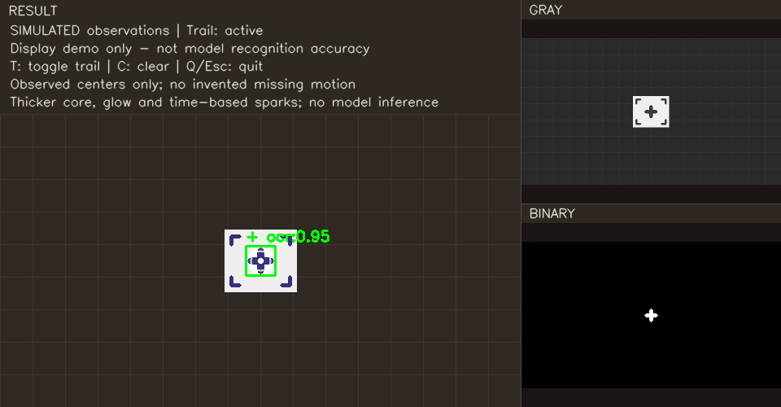

# 007 · VisualLab

本地计算机视觉学习项目：从摄像头与 OpenCV 入门，逐步扩展至通用字符识别、YOLO 模拟装甲板检测、短时追踪与粒子拖尾。主要在 MacBook Air M2 / 16GB / macOS 上开发。

**Python 3.12 · uv · OpenCV · NumPy · Ultralytics YOLO · PP-OCRv4**



> 上图是合成观测点的显示效果演示，不代表模型识别准确率或实拍跟踪成绩。项目仍处于学习与实验阶段。

## 当前功能

- 一个整齐的工作区：左侧彩色检测结果，右侧灰度与二值诊断图，独立信息栏保持完整画面比例。
- 通用文字通道：YOLO 定位文字区域，再由本地英文 OCR 读取数字、大小写字母和标点。字符表覆盖可打印 ASCII，**不代表每个字符都能可靠识别**。
- 装甲板通道：单独训练的 YOLO 直接定位现有打印模拟标记，无需 OCR 先读出加号；每帧检测并关联同一目标，短暂漏检时有受约束的 LK 光流。
- 渐隐加粗轨迹、柔光和时间粒子；目标真正丢失时停止添加位置。
- 终端与图像状态：模型、识别结果、坐标、耗时、循环 FPS、CPU/内存及可取得的全机 GPU 活动；装甲板模式显示短时 ID 与追踪状态。
- 可替换的取流、检测、Observation 输出与结果回调，为未来其他主体和云台接入保留模块边界。硬件控制、长期重识别与自动追焦尚未实现。

## 快速运行

```bash
git clone https://github.com/Mavicer/007-visuallab.git
cd 007-visuallab
uv sync --extra ocr --extra yolo
# 装甲板通道：无需下载 OCR 模型
zsh tools/run_visuallab.sh armor
# 通用文字通道：先下载并校验固定的公开 OCR 模型
uv run --extra ocr python tools/setup_ocr.py
zsh tools/run_visuallab.sh
```

macOS 请允许终端/VS Code 访问摄像头。摄像头编号可追加 `--camera 1`。可追加 `--preview-width 2000`、`--device mps` 或 `--trail off`；MPS 性能需自行实测。预览窗口按 **S** 保存原始帧、**T** 开关动效、**C** 清除轨迹、**Q/Esc** 退出。

开发机已配置的短命令：

```bash
run visuallab armor  # 整板检测与短时追踪
run visuallab        # 通用文字识别
```

其他机器可在自己的 zsh 配置中添加（将路径改为实际克隆位置）：

```zsh
run() {
  if [[ "${1:-}" == visuallab ]]; then
    shift
    /bin/zsh "$HOME/GitHub/007-visuallab/tools/run_visuallab.sh" "$@"
  else
    print -u2 '用法：run visuallab [armor] [参数...]'
    return 2
  fi
}
```

也可直接使用 Python CLI：

```bash
uv run --extra yolo python -m visuallab --backend armor --weights weights/armor-v1.pt
uv run --extra yolo python -m visuallab --backend armor --weights weights/armor-v1.pt --image path/to/frame.png --output-dir runs/check
uv run python -m visuallab --mode raw
```

## 本轮实验结果与边界

一次受限 CPU 强化训练，17 轮早停、约 208 秒；仅定位器训练，OCR 未训练。最终装甲板阈值为 .5：验证 13/13 个正样本检出、28 张负样本无误检；开发检查 8/10 检出、17 张负样本无误检。仍有两张与其他纸卡同框的小标记漏检。

新增 65 张保存帧中，43 张目标可见均检出，22 张出画均无输出；其中包含训练和相邻帧，不能视为泛化准确率。初始 .25 阈值曾把笔记本误检，阈值取舍及失败记录见 [训练与追踪说明](docs/ARMOR_TRACKING.md)。同机热身离线处理耗时中位约 55 → 27ms，**不是摄像头 FPS 或端到端延迟**。

原始采集含人像，没有公开。短时光流已用图像平移/消失测试验证，但缺少高帧率真实视频验收；真实高速、严重遮挡、陌生背景及真实 RM 装甲板不作准确性承诺。

## 项目结构

```text
visuallab/
  camera.py           # 取流、按键、结果回调与统一预览
  detection.py        # 通用观测和检测接口、传统路径
  yolo.py             # 通用对象/卡片/文字定位适配器
  tracking.py         # 短时对象关联与受约束光流
  text_regions.py     # 文本区域提取与坐标映射
  text_ocr.py         # 可替换 OCR 读取器
  text_recovery.py    # 有预算的方向与透视恢复
  geometry.py         # 角点与几何变换
  trajectory.py       # 显示层的渐隐拖尾与粒子
  preview_layout.py   # 结果/灰度/二值布局
  terminal_status.py  # 模型与资源信息
weights/              # 可运行的文字/整板试验权重与模型说明
models/               # 本机模型缓存（不提交）
tools/                # 启动、公开 OCR 模型准备、有界训练
tests/               # 离线回归与预览循环自查
```

## 开发与学习

```bash
uv run --extra ocr --extra yolo python -m unittest discover -s tests -q
```

当前 **79 项测试通过**。可以依次学习：二值化/轮廓 → 坐标与透视关系 → 定位和识别的分工 → 检测确认与光流测量 → 阈值和数据划分。完整当前设计见 [装甲板说明](docs/ARMOR_TRACKING.md)，模型范围与哈希见 [模型说明](weights/README.md)。历史实验文档仅供过程参考，当前行为以本 README 和代码为准。

## 许可与依赖

项目采用 [AGPL-3.0](LICENSE)。YOLO 依赖及派生权重沿用 Ultralytics 的 AGPL 许可；OCR/文字定位参考的 Apache-2.0 许可与来源见 [OCR 模型说明](docs/OCR_MODEL.md) 和 [文字区域说明](docs/TEXT_REGIONS.md)。代码、模型与数据来源分别说明，原始采集与开发机日志不随仓库发布。
